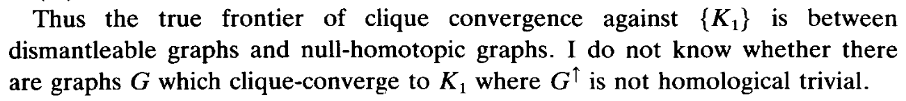
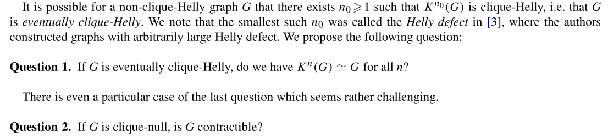
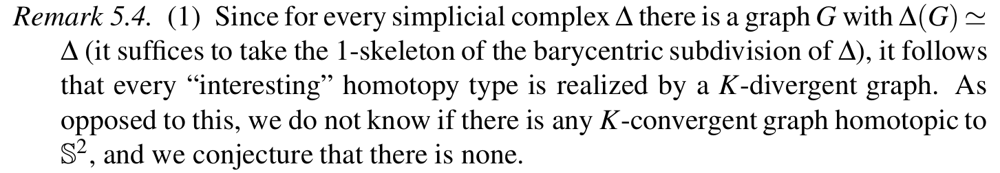
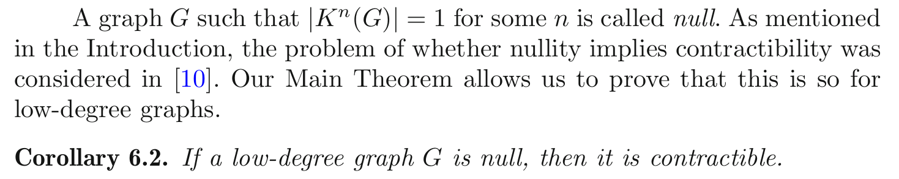

#+TITLE: Gráficas iteradas de clanes, contractibilidad y nulidad

#+AUTHOR: Rafael Villarroel Flores, UAEH
#+DATE: 17 de noviembre de 2026
#+LATEX_CLASS: beamer
#+LATEX_CLASS_OPTIONS: [aspectratio=169,10pt]
#+OPTIONS: H:2 toc:nil num:nil title:nil author:nil date:nil tags:nil
#+LATEX_HEADER: \input{preamble.tex}
#+LATEX_HEADER: \usepackage{tikz}

** Gráficas iteradas de clanes: contractibilidad y nulidad
:PROPERTIES:
:BEAMER_ENV: fullframe
:END:

#+begin_center
#+LATEX: {\Large\bfseries Gráficas iteradas de clanes\\[.2em]contractibilidad y nulidad\par}

\bigskip\bigskip

Rafael Villarroel Flores, UAEH

\bigskip\bigskip

17 de noviembre de 2026

#+LATEX: \AnimTitle{intro}
#+end_center

* El operador de clanes en gráficas

** Gráficas

*** Definición
:PROPERTIES:
:BEAMER_COL: 0.53
:END:

Consideramos solamente gráficas finitas y simples (no dirigidas, sin lazos, sin aristas múltiples).

#+latex: \bigskip

La cantidad de vértices de la gráfica \(G\) se llama el *orden* de \(G\).

*** Animación
:PROPERTIES:
:BEAMER_COL: 0.45
:END:

#+LATEX: \centering\AnimSide{graficas}

** Completas

#+begin_center
Una *completa* de una gráfica es un conjunto de vértices mutuamente adyacentes.

#+LATEX: \AnimWide{completas}
#+end_center

** Clanes

#+begin_center
Un *clan* de una gráfica es una completa maximal bajo inclusión.

#+LATEX: \AnimWide{clanes}
#+end_center

** Gráfica de clanes

*** Definición
:PROPERTIES:
:BEAMER_COL: 0.4
:END:

Dada una gráfica \(G\), su *gráfica de clanes \(K(G)\)* es la gráfica de intersección de sus clanes.

#+latex: \bigskip

Cada clan \(q\) es un vértice de \(K(G)\):

#+latex: \bigskip

Dos clanes distintos \(q,q'\), son adyacentes en \(K(G)\) si y sólo si \(q\cap q'\ne\varnothing\).

*** Animación
:PROPERTIES:
:BEAMER_COL: 0.58
:END:
#+LATEX: \centering\AnimSide{grafica_clanes}

** Suspensión de \(C_5\)

#+begin_center
Sea \(G\) la suspensión del ciclo de cinco vértices \(C_5\).
A la izquierda, \(G\); a la derecha, \(K(G)\).

#+LATEX: \AnimWide{suspension_c5}
#+end_center

** Gráficas iteradas de clanes

#+begin_center
La sucesión de *gráficas iteradas de clanes* se define mediante

\[
K^{0}(G)=G,\qquad K^{n}(G)=K\bigl(K^{n-1}(G)\bigr),\quad n\ge 1.
\]

#+LATEX: \AnimWide{iteradas}
#+end_center

** Los clanes del prisma

#+begin_center
El prisma triangular \(T_3\) tiene cinco clanes: dos triángulos y tres aristas.

#+LATEX: \AnimWide{prisma_clanes}
#+end_center

** Los clanes de \(K_{2,3}\)

#+begin_center
Los seis clanes de \(K_{2,3}\) son sus aristas.

#+LATEX: \AnimWide{prisma_k23}
#+end_center

** Iteradas del prisma

#+begin_center
El prisma triangular es periódico bajo el operador de clanes:

#+LATEX: \AnimWide{prisma}

\(T_3 \longrightarrow K_{2,3} \longrightarrow T_3\).
#+end_center

** Iteradas del octaedro

#+begin_center
Si definimos el *octaedro* \(O_n=\overline{nK_2}\), entonces: \(K(O_n)\cong O_{2^{n-1}}\) (Neumann-Lara, 1973.)

#+LATEX: \alt<1->{\AnimWide{iteradas_octaedro}}{\phantom{\AnimWidePoster{iteradas_octaedro}}}
#+end_center

** Comportamiento

*** Definiciones
:PROPERTIES:
:BEAMER_COL: 0.60
:END:

#+ATTR_BEAMER: :overlay <+->
- Se dice que \(G\) es *convergente* si la sucesión de órdenes de las iteradas de clanes es acotada.
- Esto equivale a que \(G,K(G),K^2(G),\ldots\) tenga sólo una cantidad finita de términos distintos salvo isomorfismo.
- También equivale a que \(K^m(G)\cong K^n(G)\) para algunos \(m<n\).
- En el caso de que \(K^{n}(G)\) sea una gráfica trivial (es decir, un vértice) para alguna \(n\), se dice que \(G\) es *nula*.
- Si \(G\) no es convergente, se dice es *divergente*.
- Decidir el comportamiento es un problema central del área.

*** Animación
:PROPERTIES:
:BEAMER_COL: 0.38
:END:
#+LATEX: \centering\only<+->{\AnimSide{comportamiento}}

* Complejos simpliciales

** Complejos simpliciales

#+ATTR_BEAMER: :overlay <+->
- Los *complejos simpliciales* sirven para crear fácilmente un objeto topológico a partir de un objeto combinatorio.
- Sea \(X\) un conjunto finito. Un *complejo simplicial* en \(X\) es una colección \(\Delta\) de subconjuntos de \(X\) cerrada bajo inclusión: si \(\sigma\in\Delta\) y \(\tau\subseteq\sigma\), entonces \(\tau\in\Delta\).
- Los elementos de un complejo simplicial se llaman *simplejos*.
- Si \(\sigma\) es un simplejo, su *dimensión* es \(\dim\sigma=|\sigma|-1\). Un simplejo de dimensión \(d\) se llama un *\(d\)-simplejo*.
- Sean \(X=\{1,2,3,4\}\) y
  \begin{equation*}
   \begin{aligned}
   \Delta_1=\{&\emptyset,\{1\},\{2\},\{3\},\{4\},\\
           &\{1,2\},\{1,3\},\{2,3\},\{3,4\},\{1,2,3\}\}.
   \end{aligned}
   \end{equation*}
   Entonces \(\Delta_1\) es un complejo simplicial.
- La colección
   \[
   \Delta_2=\{\emptyset,\{1\},\{2\},\{2,3\}\}
   \]
   no es un complejo simplicial, pues \(\{2,3\}\in\Delta_2\), \(\{3\}\subseteq\{2,3\}\), pero \(\{3\}\notin\Delta_2\).

** Espacio asociado

#+ATTR_BEAMER: :overlay <+->
- A cada complejo simplicial \(\Delta\) se le asocia (funtorialmente) un espacio topológico llamado su *realización geométrica*, que se denota \(|\Delta|\).
- La realización geométrica se forma poniendo un punto en algún espacio \(\mathbb{R}^{N}\) adecuado por cada \(0\)-simplejo.
- Después una línea entre los puntos correspondientes por cada \(1\)-simplejo.
- Se rellenan los triángulos correspondientes a cada \(2\)-simplejo
- Y así sucesivamente\dots

** Realización de \(\Delta_1\)

*** Simplejos
:PROPERTIES:
:BEAMER_COL: 0.50
:END:

- \(0\)-simplejos: \(\{1\},\{2\},\{3\},\{4\}\).
- \(1\)-simplejos: \(\{1,2\},\{1,3\},\{2,3\},\{3,4\}\).
- \(2\)-simplejos: \(\{1,2,3\}\).

*** Animación
:PROPERTIES:
:BEAMER_COL: 0.48
:END:
#+LATEX: \centering\AnimSide{realizacion_simplicial}

** Topología en gráficas

- Si \(G\) es una gráfica, se define \(\mathrm{Cl}(G)\) como el complejo simplicial cuyos simplejos son las subgráficas completas de \(G\). Denotamos a \(|\mathrm{Cl}(G)|\) como \(|G|\).
- Por medio de \(|G|\) asociamos conceptos topológicos a \(G\). Por ejemplo, decimos que dos gráficas son homotópicas o que una gráfica es contraíble.

#+begin_center
#+LATEX: \alt<2->{\AnimWide{topologia_graficas}}{\phantom{\AnimWidePoster{topologia_graficas}}}
#+end_center

** Gráficas desmantelables

*** Definiciones
:PROPERTIES:
:BEAMER_COL: 0.60
:END:

#+ATTR_BEAMER: :overlay <+->
- Un vértice \(x\) de \(G\) es *dominado* si existe \(y\) adyacente a \(x\) tal que todo vecino de \(x\) distinto de \(y\) es adyacente a \(y\).
- La gráfica \(G\) es *desmantelable* si puede reducirse a la gráfica de un solo vértice mediante remociones sucesivas de vértices dominados.
- Los árboles y las gráficas cordales conexas son desmantelables.

*** Animación
:PROPERTIES:
:BEAMER_COL: 0.38
:END:
#+LATEX: \centering\alt<+->{\AnimSide{desmantelables}}{\phantom{\AnimSidePoster{desmantelables}}}

** Tres clases de gráficas

*** Resultados
:PROPERTIES:
:BEAMER_COL: 0.61
:END:

#+ATTR_BEAMER: :overlay <+->
- (Prisner, 1992) Si \(x\in G\) es dominado, entonces \(G\simeq G-x\).
- Por lo tanto, si \(G\) es desmantelable, entonces \(G\) es contraíble. 
- (Prisner, 1992) Si \(G\) es desmantelable entonces \(G\) es nula.

*** Animación
:PROPERTIES:
:BEAMER_COL: 0.37
:END:  
#+LATEX: \centering\alt<+->{\AnimSide{conjuntos_dominacion}}{\phantom{\AnimSidePoster{conjuntos_dominacion}}}

** Otra aplicación de los vértices dominados

*** Resultados
:PROPERTIES:
:BEAMER_COL: 0.61
:END:

- (Frías-Armenta, Neumann-Lara, Pizaña, 2004) Si \(x\) es dominado en \(G\), entonces \(G\) y \(G-x\) tienen el mismo comportamiento.
- Es decir, si \(x\in G\) es dominado, entonces \(G\) es nula si y solo si \(G-x\) es nula.
- El octaedro \(O_3\) con dos hojas adjuntas sigue siendo divergente.

*** Animación
:PROPERTIES:
:BEAMER_COL: 0.37
:END:
#+LATEX: \centering\alt<+->{\AnimSide{dominados}}{\phantom{\AnimSidePoster{dominados}}}

** Preguntas

#+ATTR_BEAMER: :overlay <+->
- Es inmediato que \(G\) es nula si y solo si \(K(G)\) es nula.
- (Prisner, 1992) Si \(G\) es desmantelable, entonces \(K(G)\) es desmantelable.
- ¿Será cierto que si \(K(G)\) es desmantelable, entonces \(G\) es desmantelable?
- ¿Será cierto que si \(G\) es contraíble, entonces \(K(G)\) es contraíble?
- ¿Qué relación hay entre las nulas y las contraíbles?

** Ejemplos

***                                                                   :BMCOL:
:PROPERTIES:
:BEAMER_col: 0.48
:BEAMER_OPT: T
:END:

#+begin_center
#+begin_export latex
\begin{minipage}[c][4.5cm][c]{\linewidth}
\centering
\begin{tikzpicture}[scale=0.6,
  x=0.85cm, y=0.57cm,
  line width=0.65pt
]
  % Top and bottom
  \coordinate (t) at ( 0, 6);
  \coordinate (r) at ( 0,-6);

  % Upper row
  \coordinate (a) at (-3, 3);
  \coordinate (b) at (-1, 3);
  \coordinate (c) at ( 1, 3);
  \coordinate (d) at ( 3, 3);

  % Interior
  \coordinate (e) at ( 0, 2);
  \coordinate (f) at (-1, 1);
  \coordinate (g) at ( 1, 1);
  \coordinate (h) at (-2, 0);
  \coordinate (i) at ( 0, 0);
  \coordinate (j) at ( 2, 0);
  \coordinate (k) at (-1,-1);
  \coordinate (l) at ( 1,-1);
  \coordinate (m) at ( 0,-2);

  % Lower row
  \coordinate (n) at (-3,-3);
  \coordinate (o) at (-1,-3);
  \coordinate (p) at ( 1,-3);
  \coordinate (q) at ( 3,-3);

  % Edges
  \foreach \u/\v in {
    t/a,t/b,t/c,t/d,t/e,
    a/b,c/d,a/n,d/q,
    n/o,p/q,n/r,o/r,p/r,q/r,m/r,
    a/f,a/h,n/h,n/k,
    d/g,d/j,q/j,q/l,
    b/e,b/f,c/e,c/g,
    e/f,e/g,e/i,
    f/h,f/i,f/k,
    g/i,g/j,g/l,
    h/k,i/k,i/l,j/l,
    k/m,k/o,l/m,l/p,m/o,m/p,i/m} {
    \draw[AzulTitulo!65!VerdeEstructura] (\u)--(\v);
  }

  % Vertices
  \foreach \v in {
    t,a,b,c,d,e,f,g,h,i,j,k,l,m,n,o,p,q,r} {
    \fill[VerdeEstructura] (\v) circle[radius=3pt];
  }
\end{tikzpicture}
\end{minipage}
#+end_export

#+latex: \bigskip

Prisner (1992) mostró este ejemplo de una gráfica nula (y contraíble) que no tiene vértices dominados, por lo tanto, no es desmantelable.
#+end_center

***                                                                   :BMCOL:
:PROPERTIES:
:BEAMER_col: 0.48
:BEAMER_OPT: T
:END:

#+begin_center
#+begin_export latex
\begin{minipage}[c][4.5cm][c]{\linewidth}
\centering
\begin{tikzpicture}[scale=0.75,
  x=1.25cm, y=1.25cm,
  line width=0.65pt
]
  % Outer square
  \coordinate (a) at (-2, 2);
  \coordinate (b) at ( 2, 2);
  \coordinate (c) at (-2,-2);
  \coordinate (d) at ( 2,-2);

  % Inner vertices
  \coordinate (u) at ( 0, 1.2);
  \coordinate (l) at (-1.2,0);
  \coordinate (r) at ( 1.2,0);
  \coordinate (v) at ( 0,-1.2);

  % Edges
  \foreach \s/\t in {
    a/b,a/c,b/d,c/d,
    a/u,b/u,
    a/l,c/l,
    b/r,d/r,
    c/v,d/v,
    u/l,u/r,u/v,l/v,r/v} {
    \draw[AzulTitulo!65!VerdeEstructura] (\s)--(\t);
  }

  % Vertices
  \foreach \w in {a,b,c,d,u,l,r,v} {
    \fill[VerdeEstructura] (\w) circle[radius=3pt];
  }
\end{tikzpicture}
\end{minipage}
#+end_export

#+latex: \bigskip

Ejemplo en (Larrión, Pizaña, VF, 2008) de una gráfica nula que no es desmantelable. Pero su gráfica de clanes es desmantelable.
#+end_center

** COMMENT Dominación y clan comportamiento

*** Resultados
:PROPERTIES:
:BEAMER_COL: 0.61
:END:

- (Frías-Armenta, Neumann-Lara, Pizaña, 2004) Si \(x\) es dominado en \(G\), entonces \(G\) y \(G-x\) tienen el mismo comportamiento.
- Por ejemplo, el octaedro \(O_3\) con dos hojas adjuntas sigue siendo divergente.

*** Animación
:PROPERTIES:
:BEAMER_COL: 0.37
:END:
#+LATEX: \centering\alt<+->{\AnimSide{dominados}}{\phantom{\AnimSidePoster{dominados}}}

** COMMENT Homotopía y el operador de clanes

*** Prisner (1992)
:PROPERTIES:
:BEAMER_COL: 0.48
:END:

#+LATEX: \centering\includegraphics[page=1,width=.99\linewidth,height=.71\textheight,keepaspectratio]{papers/prisner_1992.pdf}
#+LATEX: \par\vspace{.15em}\raggedright\SmallText

Prisner planteó en 1992 la pregunta: ¿cuándo es \(G\simeq K(G)\)? Dio una condición suficiente: cuando \(G\) es clan-Helly.

*** Larrión, Pizaña y Neumann-Lara (2001)
:PROPERTIES:
:BEAMER_COL: 0.48
:BEAMER_ACT: <2->
:END:

#+LATEX: \centering\includegraphics[page=1,width=.99\linewidth,height=.71\textheight,keepaspectratio]{papers/larrion_2001.pdf}
#+LATEX: \par\vspace{.15em}\raggedright\SmallText

Larrión, Pizaña y Neumann-Lara generalizaron en 2001 el resultado de Prisner.

* Topología y gráficas de clanes

** La propiedad de Helly

*** Resultados
:PROPERTIES:
:BEAMER_COL: 0.58
:END:

#+ATTR_BEAMER: :overlay <+->
- Una colección \(\mathcal{C}\) de subconjuntos de \(X\) es *intersecante* si dos cualesquiera de sus miembros tienen intersección no vacía.
- La colección \(\mathcal{C}\) tiene la propiedad de Helly si toda subfamilia intersecante tiene intersección total no vacía.
- La gráfica \(G\) es *disco-Helly* si la colección de discos \(\{D_{r}(x)\mid x\in G, r>0\}\) tiene la propiedad de Helly.
- Una gráfica \(G\) es *clan-Helly* si su colección de clanes satisface la propiedad de Helly.
- La *pirámide* es la gráfica no clan-Helly más pequeña.

*** Animación
:PROPERTIES:
:BEAMER_COL: 0.40
:END:
#+LATEX: \centering\alt<+->{\AnimSide{piramide}}{\phantom{\AnimSidePoster{piramide}}}

** Propiedades de las gráficas clan-Helly

#+ATTR_BEAMER: :overlay <+->
- Las gráficas sin triángulos son clan-Helly. También lo son las gráficas completas y el prisma triangular.
- Existe un algoritmo polinomial que decide si una gráfica es clan-Helly (Dragan, 1989; Szwarcfiter, 1997).
- (Bandelt, Prisner, 1991) Para \(G\) una gráfica conexa, son equivalentes:
  - \(G\) es disco-Helly,
  - \(G\) es clan-Helly y desmantelable,
  - \(G\) es clan-Helly y nula
- Por lo tanto, dentro de las clan Helly es equivalente ser desmantelable a ser nula.
- (Chalopin, Chepoi, Hirai, Osajda, 2020) Si \(G\) es clan-Helly y simple-conexa, entonces \(G\) es disco-Helly.
- *Corolario:* Entre las clan-Helly, es equivalente ser desmantelable, nula y contraíble.

** COMMENT Teoremas de Escalante

#+ATTR_BEAMER: :overlay <+->
- (Escalante, 1973) Si \(G\) es clan-Helly, entonces \(G\) es convergente.
- (Escalante, 1973) Si \(G\) es clan-Helly, \(K(G)\) es clan-Helly.
- Corolario: Si \(G\) es clan-Helly, entonces \(K^{n}(G)\simeq G\) para todo \(n\).
- Existen gráficas no clan-Helly cuyo gráfica de clanes sí es clan-Helly, como la pirámide.
- De aquí se obtiene que toda gráfica \(G\) tal que \(|G|\leq 5\) es convergente.

* Nulidad y contractibilidad

** Prisner y los números de Betti (1992)

#+ATTR_BEAMER: :overlay <+->
- Escribamos \(\beta_i(G)=\dim_{\mathbb F_2}H_i(|G|;\mathbb F_2)\).
- *Teorema (Prisner):* Para toda gráfica \(G\),
  \[
  \beta_1(G)=\beta_1(K(G)),\qquad \beta_2(G)\geq\beta_2(K(G)).
  \]
- El número de componentes \(\beta_0\) también se conserva.
- *Corolario:* Si \(G\) es nula, entonces \(\beta_1(G)=0\).
- (Larrión, Pizaña, VF, 2009) Para toda gráfica conexa \(G\) se tiene que \(\pi_{1}(|G|)\cong\pi_{1}(|K(G)|)\).
- *Corolario:* Si \(G\) es nula, entonces \(\pi_{1}(|G|)\) es trivial.

** Pregunta (implícita) de Prisner

E. Prisner, /Convergence of iterated clique graphs/, *Discrete Mathematics* 103 (1992), 199--207.

** COMMENT Esferas que divergen

#+begin_center
Para el octaedro \(O_n=\overline{nK_2}\),
\[
|O_n|\cong S^{n-1},\qquad K(O_n)\cong O_{2^{n-1}}.
\]

#+LATEX: \AnimWide{betti_octaedros}
#+end_center

#+ATTR_BEAMER: :overlay <2->
Así, las esferas \(S^2,S^3,S^7,\ldots\) aparecen en una sucesión *divergente*.

** COMMENT Una intuición razonable, pero incompleta

#+ATTR_BEAMER: :overlay <+->
- Las iteradas del octaedro producen homología en dimensiones cada vez mayores.
- La presencia de homología de dimensión alta parecía un indicio de comportamiento divergente.
- *Pero la divergencia no exige una topología complicada:* hay gráficas divergentes homotópicas a \(S^1\) en todas sus iteradas.
- Las familias de *clockwork graphs* y de gráficas localmente \(C_6\) lo muestran (Larrión, Pizaña y Villarroel-Flores, 2008).

#+LATEX: \vfill
#+LATEX: {\scriptsize /Equivariant collapses and the homotopy type of iterated clique graphs/, Discrete Math. 308 (2008), 3199--3207.}

** No todas las contraíbles son nulas

*** Construcción
:PROPERTIES:
:BEAMER_COL: 0.48
:END:

- Se construye una cierta triangulación \(H\) de un disco: \(|H|\) es contraíble.
- Se forma la *suspensión* \(G=\operatorname{Susp}(H)\) agregando dos vértices no adyacentes, unidos a todo \(H\).
- Entonces \(|G|\) es una suspensión de un disco: *es contraíble*.
- (2008,Larrión, Pizaña, VF) \(G\) es contraíble, pero divergente. En particular, no es nula.
- Además, \(K(G)\) no es contraíble.

*** Animación
:PROPERTIES:
:BEAMER_COL: 0.50
:END:
#+LATEX: \centering\AnimSide{disco_suspension}

** ¿Por qué es divergente la suspensión?

- En \(K(H)\) hay un ciclo inducido \(C_4\) cuyos vértices opuestos no tienen vecinos comunes fuera de él.
- Esto permite construir una retracción:
  \[
  K(\operatorname{Susp}H)\longrightarrow O_4.
  \]
- Como \(O_4\) es divergente, también lo es \(G=\operatorname{Susp}H\).

** Otros teoremas del 2008

#+ATTR_BEAMER: :overlay <+->
- No es cierto que contraíble implique nula, pero la implicación al revés quedó abierta.
- Teorema: si \(K(G)\) es un cono (tiene un vértice universal), entonces \(G\) es contraíble.
- En particular, si \(K^{2}(G)\) es un solo vértice, se deduce que \(G\) es contraíble. 

** Otra pregunta del 2008

F. Larrión, M. A. Pizaña y R. Villarroel-Flores, /Equivariant collapses and the homotopy type of iterated clique graphs/, *Discrete Mathematics* 308 (2008), 3199--3207.

** Pregunta en el 2013

F. Larrión, M. A. Pizaña y R. Villarroel-Flores, /Discrete Morse Theory and the Homotopy Type of Clique Graphs/, *Annals of Combinatorics* 17 (2013), 743--754.

** Pregunta en el 2024

M. Islas-Gómez  y R. Villarroel-Flores, /On the Homotopy Type of the Iterated Clique Graphs of Low Degree/, *Annals of Combinatorics* 28 (2024), 367--378.

* Contraejemplos

** Dos gráficas nulas que no son contraíbles

#+begin_center
Dos ejemplos con *10 vértices y 30 aristas* cada uno.

#+LATEX: \AnimWide{dos_ejemplos_s2}

graph6: =ICvbvy}|g= y =IEivrzm}o=.
#+end_center

** Ambas tienen tipo \(S^2\)

#+begin_center
En cada complejo de completas se pueden ejecutar *20 colapsos simpliciales elementales*.

#+LATEX: \AnimWide{colapsos_s2}

Resultan triangulaciones de la esfera \(S^2\).
#+end_center

** Certificado de la homotopía

Las reducciones de ambos ejemplos dejan un complejo simplicial de dimensión dos:

| Gráfica | Vértices | Aristas | Triángulos | Colapsos |
|---------+----------+---------+------------+----------|
| \(G_1\) |        8 |      18 |         12 |       20 |
| \(G_2\) |        8 |      18 |         12 |       20 |

#+ATTR_BEAMER: :overlay <+->
- Cada arista pertenece a dos triángulos y la vecindad de cada vértice es un ciclo.
- El complejo es una superficie cerrada conexa y
  \[
  \chi=8-18+12=2.
  \]
- Por clasificación de superficies, resultan esferas, por tanto, \(|G_1|\simeq|G_2|\simeq S^2\).
- Otra manera de verlo es que ambas gráficas tienen un vértice cuya vecindad abierta es un ciclo \(C_{5}\), y al quitar tal vértice, queda una gráfica contraíble.

** Ambas gráficas son nulas

#+begin_center
Los órdenes de sus primeras iteradas son:

#+LATEX: \AnimWide{iteradas_nulas}
#+end_center

** Nulidad

#+ATTR_BEAMER: :overlay <+->
- \(K^3(G_1)\) tiene 63 vértices y es desmantelable.
- \(K^3(G_2)\) tiene 65 vértices y es desmantelable.
- Por el teorema de Prisner, ambas gráficas son *nulas*.
- Sin embargo, \(|G_1|\simeq |G_2|\simeq S^2\): ninguna es contraíble.
- \(K^{4}(G_{1})\) tiene 8,794 vértices y 38,070,438 aristas. \(K^{4}(G_{2})\) tiene 9,673 vértices y 46,149,308 aristas.

** Implicaciones falsas

#+ATTR_BEAMER: :overlay <+->
- \(\text{Contraíble}\;\not\Rightarrow\;\text{Nula}\): el ejemplo \(G=\operatorname{Susp}H\) de 2008 es contraíble y divergente.
- \(\text{Nula}\;\not\Rightarrow\;\text{Contraíble}\): \(G_1\) y \(G_2\) son nulas y tienen tipo \(S^2\).
- Se cumple que existe \(n\) tal que \(K^n(G_1)\) y \(K^n(G_2)\) son clan-Helly, y sin embargo, ni \(G_{1}\) ni \(G_{2}\) son homotópicamente permanentes.
- Se cumple que existe \(n\) tal que \(K^n(G_1)\) y \(K^n(G_2)\) son clan-Helly, y sin embargo, son homotópicas a \(S^{2}\)
- Los ejemplos \(G_1,G_2\), sus colapsos y los desmantelamientos de \(K^3(G_i)\) son *cálculos reproducibles*:
  #+begin_center
  #+LATEX: \texttt{python scripts/verify\_s2\_null.py}
  #+end_center

** 

#+begin_center
FIN

#+LATEX: \AnimWide{dos_ejemplos_s2}
#+end_center

# Local Variables:
# ispell-dictionary: "castellano"
# End:
